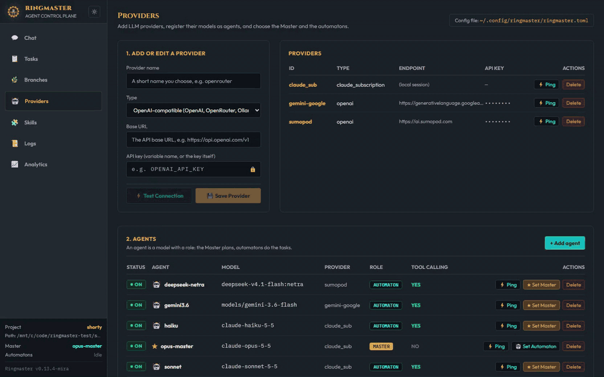
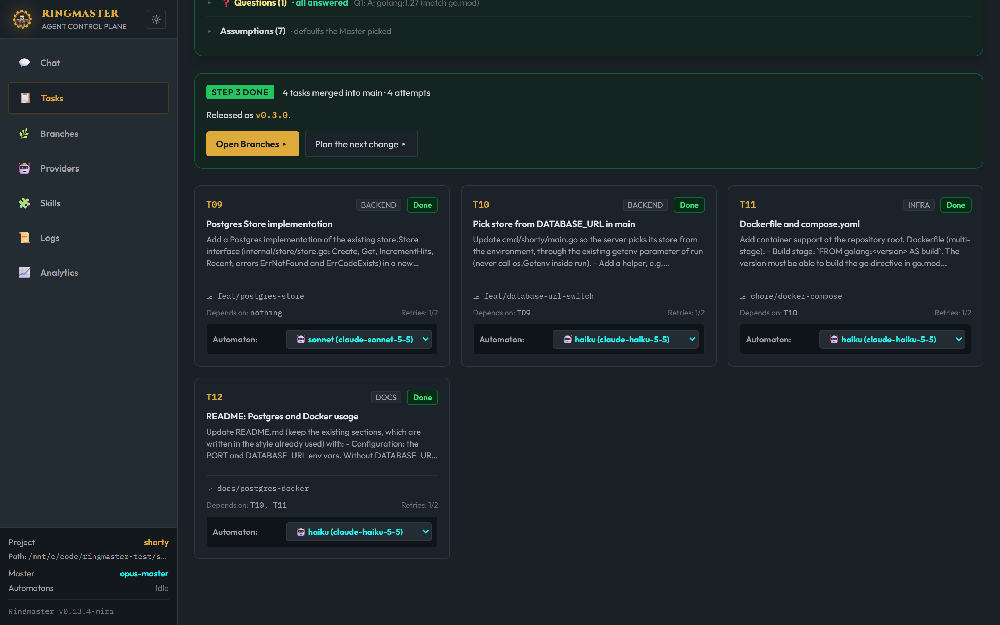
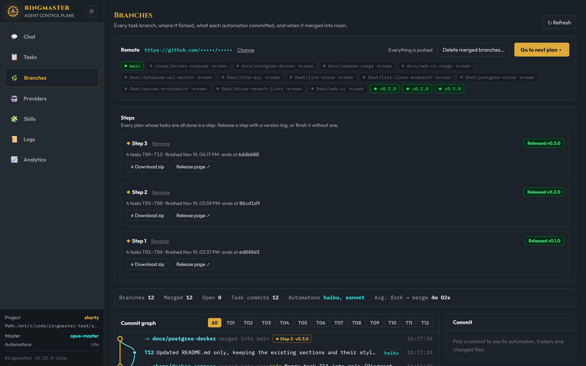
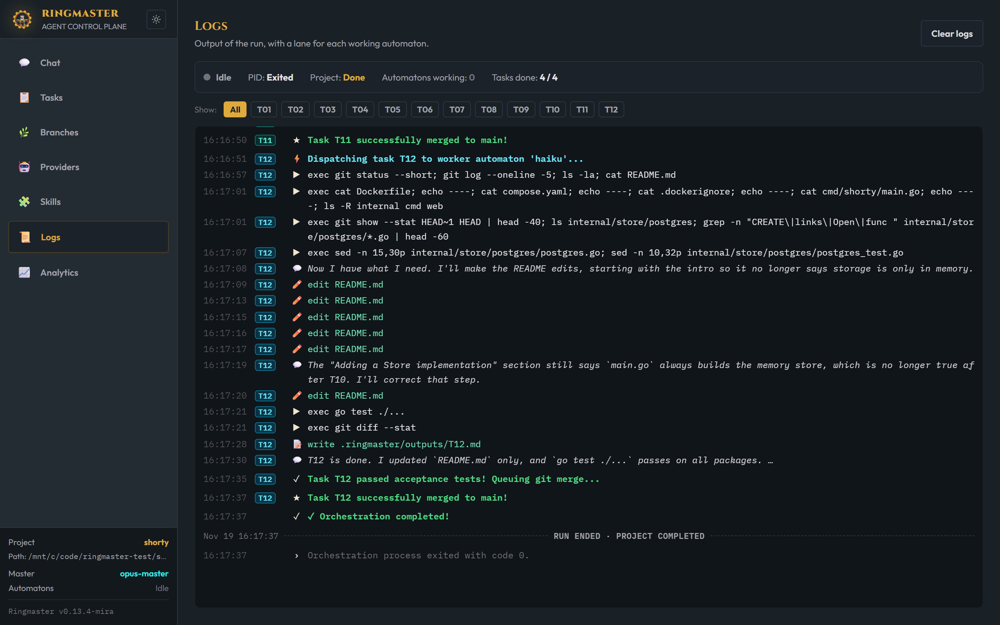
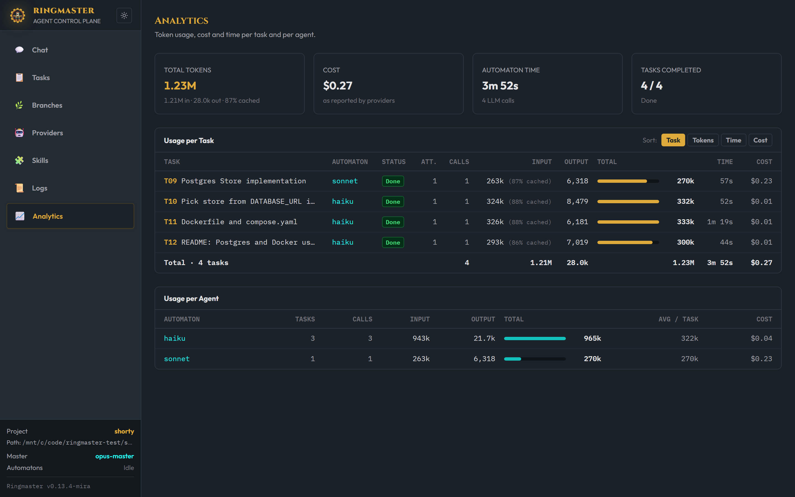
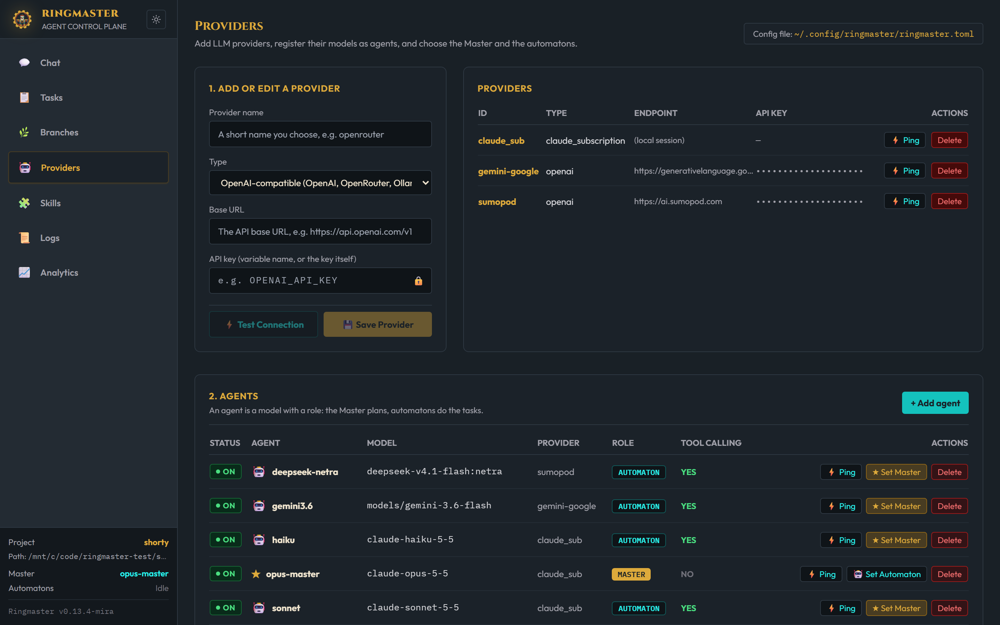

<p align="center">
  
</p>

# 🎪 Ringmaster

**A local control plane for teams of AI coding agents.**

Describe what you want built. Ringmaster plans it as a graph of tasks, gives each task to an AI worker in its own git worktree, runs real checks on the result, and merges only what passes into `main`. You watch, answer questions and approve from a web UI or the terminal.

Current release: **v0.13.4-mira** · Linux and macOS · MIT

<p align="center"></p>

## Why Ringmaster

- **Checks, not trust.** Ringmaster runs each task's acceptance commands itself instead of believing the worker's report. A worker's edits to existing tests are undone before the checks run, so a test cannot be passed by rewriting it.
- **Nothing runs without you.** You approve the plan before any work starts. A worker that needs a command outside its allowlist, a decision or a value only you know stops and asks.
- **Your repository, your history.** It works in an existing repo without adding anything to git. Every attempt is a commit under your name, tagged with the task and the model that made it. Nothing leaves your machine until you push.
- **Any model, side by side.** OpenAI-compatible APIs (OpenAI, Google Gemini, OpenRouter, DeepSeek, Ollama, vLLM and others), the Anthropic API, and a Claude subscription through the Claude Code CLI. Use a strong model to plan and cheaper ones to do the work. See [adding a provider](docs/guide/configuration.md#adding-a-provider).
- **Parallel by default.** Independent tasks run at the same time, each on its own branch; dependent ones start from the branch they depend on.
- **Everything visible.** Live logs per worker, transcripts of every attempt, and tokens, cost and time per task.

| Tasks | Branches |
|---|---|
|  |  |
| **Logs** | **Analytics** |
|  |  |

<p align="center"><br /><sub>One fleet, many models: pick a master to plan and any mix of automatons to do the work.</sub></p>

## How it works

1. **Brief.** Tell the master planner what to build, in chat or in `.ringmaster/BRIEF.md`.
2. **Plan.** It splits the brief into a DAG of tasks, each with a worker, dependencies and acceptance commands, and asks about anything it should not guess. You approve.
3. **Run.** Each task gets a branch (`feat/link-store`) and a worktree; workers run in parallel where dependencies allow.
4. **Verify.** Ringmaster runs the acceptance commands. Failures go back to the worker; problems it cannot fix come to you.
5. **Merge.** Passing tasks are merged into `main` one at a time, without touching your checkout.

More in [the workflow guide](docs/guide/workflow.md).

## Install

```bash
curl -fsSL https://raw.githubusercontent.com/rigels-dev/ringmaster/main/install.sh | sh
# or
brew install rigels-dev/tap/ringmaster
```

The script downloads the latest release, checks its SHA-256 and links `ringmaster` into `~/.local/bin`; run it again to upgrade. You need git 2.38 or newer, and Node.js 22 or newer for the web UI (the CLI works without it). To build from source (Go 1.27+):

```bash
git clone https://github.com/rigels-dev/ringmaster.git && cd ringmaster
make build web && ln -s "$PWD/bin/ringmaster" ~/.local/bin/ringmaster
```

## Quickstart

```bash
ringmaster config        # once: add providers and agents, pick the master and default worker
cd my-repo && ringmaster init     # or: ringmaster init new-project
ringmaster               # open the web UI (http://localhost:2053) or the TUI
```

Or from the command line:

```bash
ringmaster plan          # generate the plan, review it, press y to approve
ringmaster run -p 4      # run up to 4 tasks in parallel
ringmaster status --watch
ringmaster answer T03 --text "Use SQLite"
ringmaster push          # publish main and the task branches
```

## Documentation

| Guide | What is in it |
|---|---|
| [Workflow](docs/guide/workflow.md) | Briefs, plans, acceptance commands, answering a waiting task, the web UI |
| [Configuration](docs/guide/configuration.md) | The fleet config, the project manifest, command presets, budgets, ports |
| [Safety](docs/guide/safety.md) | Guardrails, protected tests, what a worker sees |
| [Skills](docs/guide/skills.md) | Giving every worker your own instructions |
| [Publishing](docs/guide/publishing.md) | Pushing, steps, releases and release notes |
| [Reference](docs/guide/reference.md) | Project layout, branch names, commit trailers, versioning |

## Contributing

Bug reports and pull requests are welcome; see [CONTRIBUTING.md](CONTRIBUTING.md).

## License

MIT; see [LICENSE](LICENSE).
